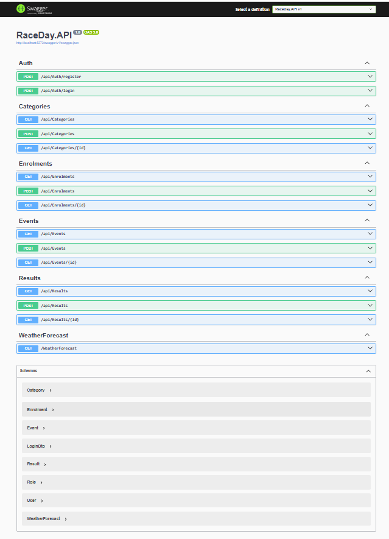

# PROG6212_PoE_(Part 1 & Part 2)

# RaceDay - Full-Stack Event Management Platform

## Project Overview
RaceDay is a full-stack event management system designed specifically for the South African road running, walking, and cycling community. It replaces paper-based registrations and spreadsheets with a centralized digital platform for organisers and participants.

## System Roles
The system enforces role-based access control with two primary roles:
* **Organiser:** Can create, edit, and delete events, manage event categories, capture participant results, and view event enrolments.
* **Participant:** Can create an account, browse upcoming events, enter events by selecting categories, view personal enrolments, and track race performance history.

## PoE Part 1 - Documentation & Structure
All planning and database assets are located in the `/docs` folder:
* `erd_diagram.png`: Entity Relationship Diagram (Crow's Foot notation, 6 entities).
* `api_endpoint_plan.md`: Comprehensive RESTful API endpoint specification table.
* `RaceDay_Database_Script.sql`: Complete SQL Server script with schema creation, constraints, and realistic seed data.

## PoE Part 2 - Web API Implementation & Database Integration

Part 2 implements the complete backend RESTful Web API using **.NET 8** and **Entity Framework Core**, backing the planning and database design established in Part 1.

### Key Features Implemented
- **Role-Based Authentication & Authorization:** Implemented `AuthController` for user registration, login, and secure role checking.
- **Event & Category Management:** Implemented `EventsController` and `CategoriesController` for CRUD operations on events and categories.
- **Participant Registrations:** Implemented `EnrolmentsController` to manage event registrations and link participants with navigation properties.
- **Race Results:** Implemented `ResultsController` to capture and query participant outcomes and race timing.
- **EF Core Database Migrations & Seeding:** Configured `RaceDayDbContext` with full navigation properties, relationships, SQL Server LocalDB connection, and seed data.
- **OpenAPI / Swagger Integration:** Configured Swagger UI in `Program.cs` for interactive API documentation and endpoint testing.

### API Endpoints Summary

| HTTP Method | Endpoint | Description | Access Level |
| :--- | :--- | :--- | :--- |
| `POST` | `/api/auth/register` | Register a new user account | Public |
| `POST` | `/api/auth/login` | Authenticate user and issue session context | Public |
| `GET` | `/api/events` | Retrieve all upcoming race events | Public |
| `POST` | `/api/events` | Create a new race event | Organiser |
| `GET` | `/api/categories` | List all event categories | Public |
| `POST` | `/api/enrolments` | Register a participant for an event | Participant |
| `GET` | `/api/enrolments` | View enrolments with participant details | Organiser / Self |
| `GET` | `/api/results` | Fetch race results including enrolment details | Public |
| `POST` | `/api/results` | Capture race outcomes and completion times | Organiser |

### Getting Started & Running the API

1. **Prerequisites:**
   - .NET 8.0 SDK
   - Visual Studio 2022 / 2026 with the **ASP.NET and web development** workload
   - SQL Server Express / LocalDB

2. **Database Setup:**
   Open the **Package Manager Console** in Visual Studio and run:
   ```powershell
   Update-Database
   
### API Testing Screenshots


## Video Presentation part 1
[Click here to watch the Video Presentation](https://youtube.com/shorts/NRz5mpCMPxc?si=b0Ifq47R1GCRHoBg)

## CI/CD Pipeline


## References

* **Dahl, R.** (2020) *Building RESTful APIs with C# 9 and .NET 5*. 2nd edn. Birmingham: Packt Publishing.
* **Elmasri, R. and Navathe, S.B.** (2016) *Fundamentals of Database Systems*. 7th edn. Boston: Pearson.
* **GitHub Actions** (2024) *Understanding GitHub Actions*. Available at: https://docs.github.com/en/actions/learn-github-actions/understanding-github-actions (Accessed: 4 September 2026).
* **Microsoft** (2024) *SQL Server Technical Documentation*. Available at: https://learn.microsoft.com/en-us/sql/sql-server/ (Accessed: 4 September 2026).
* **OpenAPI Initiative** (2021) *OpenAPI Specification v3.1.0*. Available at: https://spec.openapis.org/oas/v3.1.0 (Accessed: 4 September 2026).
* **Pressman, R.S. and Maxim, B.R.** (2020) *Software Engineering: A Practitioner's Approach*. 9th edn. New York: McGraw-Hill Education.

* **Freeman, A.** (2022) *Pro ASP.NET Core 6: Develop Cloud-Ready Web Applications Using MVC, Blazor, and Web API*. 9th edn. New York: Apress.
* **Microsoft.** (2024) *ASP.NET Core Web API documentation*. Available at: https://learn.microsoft.com/en-us/aspnet/core/web-api/ (Accessed: 12 October 2026).
* **Microsoft.** (2024) *Overview of Entity Framework Core*. Available at: https://learn.microsoft.com/en-us/ef/core/ (Accessed: 12 October 2026).
* **Richardson, L. and Ruby, S.** (2007) *RESTful Web Services*. Sebastopol: O'Reilly Media.
* **SmartBear Software.** (2024) *Swagger / OpenAPI Documentation*. Available at: https://swagger.io/docs/ (Accessed: 12 October 2026).
